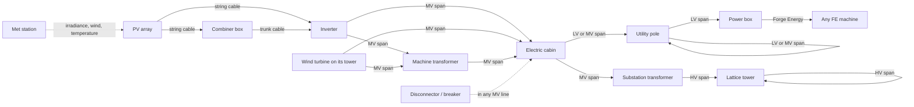
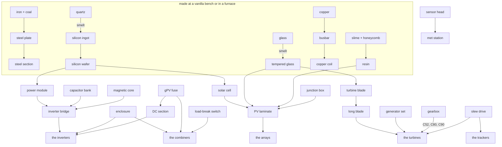

# Everything in the mod, and what it connects to

Written to answer four questions about the whole of it rather than about one machine at a time: does
every item work, does it make sense, is it usable, and does what connects to what match the way a real
plant is put together. The last section is the one that matters most — what is *missing*.

Seventy-six obtainable things. Every one of them has a recipe, an item model, a sprite and a name, and
`tools/gen_crafting.py` refuses to write a tree where that is not true.

## The two power chains, and where they meet

There are two, and they are separate on purpose because they are separate in reality: direct current on
the array side of an inverter, alternating current after it.

**DC side.** A row is connected when a run of copper meets what it has drawn at one of its two ends: its
socket, which is always there, or its own lead, which exists once a reel of string cable has been worked
in. So the reel is what carries the connection on to the *next* row — a line of six tables off one cable
takes five of them — and the row at the end of the line needs none. From there a run of cable reaches
either a combiner box or an inverter with fused string terminals, and `DcNetwork` follows the copper
rather than a radius while `PvStrings` follows the harnesses, so what a player sees connected is what the
plant counts. Length costs what copper costs: 200 m of
6 mm² at a string's own current is 2.8% lost, and the same strings paralleled into one 240 mm² trunk is
1.0%. That difference is the reason a combiner box exists, and the panel says so.

**AC side.** It works on fittings and spans: a machine carries insulators or bushings, a span of one of
three conductors joins two of them, and every server tick the grid (`grid/Grid`, one network per level, solved
by `GridSolver`) carries what the generators make down the spans to every machine. Which machine may feed
which is fixed (see [Getting started](getting-started.md#who-feeds-whom)), and each conductor goes on its own
voltage class: aerial bundled cable at 1 kV, the medium-voltage conductor at 33 kV, the quad bundle at 420 kV.
A power box turns what arrives into Forge Energy for anything else in the pack.

**The met station is not in either chain.** It measures and reports — irradiance on three planes, albedo,
air and module temperature, wind, snow — and one mast serves a whole plant.

## What each thing is for

### Tools and instruments

| item | what it does |
|---|---|
| Power Wrench | right-click any machine, or point at one up to 16 blocks away, to open its panel — or, for a machine with no panel, a card with the power through it |
| Aerial Bundled Cable | low voltage: cabin to pole, pole to pole, pole to power box. Four blocks of span per reel, 40 at most |
| Medium-Voltage Conductor | 33 kV: generators, transformers, cabins, poles and switches. Eight blocks per reel, 90 at most |
| High-Voltage Conductor | 420 kV, a quad bundle: substation transformers and lattice towers. Sixteen blocks per reel, 160 at most |

Used on a block that is not a machine, a reel lays a **run** of its conductor on the ground (Bundle Run,
Medium-Voltage Run, Transmission Run). Each run block carries one dead-end fitting a span can be strung to,
which is how a line comes down into a yard without poles.

### Direct current

| item | what it does | connects to |
|---|---|---|
| DC String Cable (6 mm²) | right-click an array to fit its leads; sneak on soil to bury it; anything else lays it like redstone | arrays, combiners, string terminals on inverters |
| DC Trunk Cable (240 mm²) | the home run, and it will not join a string cable — different terminals in reality, one rule here | combiners, busbars on central inverters |
| Combiner Box CB-6 / CB-16 / CB-32 | one gPV fuse per pole per string, a surge arrester and an output load-break switch. Empty hand throws the switch, which takes the group off the machine and leaves the strings live — because they are | strings in, one trunk out; or fitted inside a central inverter |

### The arrays

Six products, one block each, all of them a mounting with modules on it. What differs is what differs in
a real plant: the mounting, and what the modules are.

| array | mounting | modules | notes |
|---|---|---|---|
| FT-415 (`solar_panel`) | flat ballasted table | HP-108-415 | the entry-level table, and the registry name the mod started with |
| FT-430 | flat ballasted table | HJ-132-430 | ballast trays, a heterojunction module |
| TR-530 / TR-580 | fixed rack at 25° | HT-268-530 (CdTe) / HN-144-580 | the 580 is the large-format bifacial module, so it takes a fourth laminate of silicon |
| HX-700 | single-axis tracker | HN-132-700 | a torque tube and one slew drive; the tube is forced north-south, because that is the only axis a row can follow the sun from |
| AE-440 | dual-axis pedestal | HB-066-440 | two slew drives, because it has two axes |

### The inverters

| machine | what it is | DC terminals |
|---|---|---|
| VX-10K | a wall string inverter with one regulated fan | four strings into two MPPTs |
| VX-110K | a big string inverter with fans | eighteen strings into nine MPPTs |
| VX-350K | the "virtual central" machine | thirty-two strings on sixteen MPPTs *and* trunks — the only one that takes both |
| VC-2500K | a central inverter in a container | busbars only, so it cannot take a string without a combiner (or one fitted inside it) |

Each has one AC insulator on its roof, strung in medium voltage to a cabin or a machine transformer. The cabinet
is drawn at three sizes — a wall box, a cabinet, a container — and the insulator moves with it.

That last row is a rule and not a limitation: a central inverter has no fused string inputs, which is
precisely why combiner boxes are on the market. The panel names each machine's terminals, because it is
the one thing you cannot see from outside and have to know before laying a metre of cable.

### Wind

| item | what it does |
|---|---|
| Turbine Tower | stack it to the height you want; above 16 blocks a bare pile folds under anything that steps on it, and above 20 it folds as it is built |
| SW-10 | small wind, 10 kW: a tail vane on a small nacelle, and no gearbox or slew drive in its recipe |
| C52-0.85 … C130-4.0 | the utility line. The letter is the maker and the number is the rotor in metres, exactly as a real datasheet reads. The C112 and the C130 are direct drive, so their recipes take no gearbox |

The turbine's insulator stands beside the foot of its tower, where a real one gathers its cables, and takes the
medium-voltage conductor.

### The grid

| item | what it does | fittings |
|---|---|---|
| Electric Cabin | where generators are collected: input at the far end of the roof, output at the door end | two; low or medium voltage |
| Utility Pole | carries a line; its head can be moved and tilted with an empty hand | eight, one busbar; low or medium voltage |
| Power Box | the end of a line: Forge Energy to the six blocks touching it, power to its field. Stands on the ground or hangs on a wall | one on the roof; low voltage only |
| Machine Transformer | VT-2500 Pad, 2.5 MVA, 800 V to 33 kV, beside a generator; an empty hand reads its ratio, load and loss | three bushings; medium voltage |
| Substation Transformer | VT-63000 Grid, 63 MVA, 33 kV to 400 kV: where a transmission line starts | six bushings: 1–3 medium, 4–6 high |
| Disconnector | AB-36/630, on a 33 kV line; thrown with an empty hand or by a redstone edge, and refuses to open on load | six: line side 1–3, load side 4–6 |
| Circuit Breaker | VB-36/630, on a 33 kV line; opens on load, and trips by itself above 36 MW | six, as the disconnector |
| Suspension / Tension / Terminal Tower | the three 400 kV lattice towers | six each; high voltage only |

### Measurement and control

| item | what it does |
|---|---|
| Meteorological Mast | nine instruments on one bus: global, diffuse and plane-of-array irradiance, albedo, air and module temperature, wind, snow. One mast serves a whole plant |
| Plant Controller | holds every inverter and turbine within 64 blocks to a plant-wide limit, set on its panel or by redstone; switched off, broken, or when a machine leaves its range, it gives each back the limit it had |

A machine refuses to mount outside the range of tower heights it is certified for — both ends, because
the low end is physics: the blades would be in the ground.

### The parts

Thirty-two of them, in three tiers, and none is placeable or usable: they exist to be ingredients.
`PartCatalog` is the list and every entry says what it is for, because for a part nobody can hold to any
purpose that tooltip is the only way to tell what it belongs to.

## Is it coherent? What the pass found

**Every product of one kind shares a recipe spine, and differs where the machines differ.** That was the
requirement and it holds: three laminates over a mounting for every array, bridges over an enclosure for
every inverter, fuse ways over an enclosure for every combiner, three blades over a drivetrain for every
turbine. A reader can see the difference between two machines by laying their recipes side by side, which
is the point.

**No two recipes share a grid.** Checked, because the failure is silent: the game indexes whichever it
read first and the other product simply cannot be made, with nothing in any log.

**Nothing is made and never used.** Also checked. A part that is craftable, useless and undocumented
costs a player an evening.

**Every machine says what it needs.** An array with no leads says so; an array whose collector is out of
reach says so; a combiner fitted to a machine that has its own fused terminals is refused *with the
reason*, which is that a string inverter's terminals are the fusing and a second set would be a fuse in
series with a fuse.

## What is missing, and what I would do about it

These came out of writing the table, and none of them is a bug — they are the gaps.

1. **A combiner cannot feed another combiner.** Real plants do exactly that: string combiners into a
   recombiner. `DcNetwork` stops at machines by design, so this would be a rule change rather than a
   bug fix, but it is the one topology a player will try and be surprised by.

2. **Nothing consumes the met station's measurements except the panels.** The instruments are real, the
   figures are real, and the plant does not read them: an array computes its own irradiance. Wiring the
   mast's plane-of-array reading into a tracker's backtracking decision is the obvious use, and it is
   what a real plant does with it.

3. **The transformers' losses are shown but not taken.** Both transformers work out their core and copper
   losses, and an empty hand on the tank reads them out, but the grid carries power across one as if it were a pole,
   and the kVA rating limits nothing. Taking the loss off the flow (and tripping on overload) would make the
   voltage figures on the panels mean something end to end.

4. **A tower's own span limit is not enforced.** Each tower is rated for a ruling span (160 blocks for a
   suspension tower, 200 for the others), but only the conductor's own 160-block limit stops a span.

5. **The first `solar_panel` and `power_box` predate the catalogue.** They work, and they now sit in
   the same crafting tree as everything else, but the power box converts to Forge Energy at a fixed rate
   with no mention of voltage — where every other machine in the mod is careful about it. It does at least
   take low voltage only, so a 33 kV line has to come down through a pole first.

6. **No fault state is repairable.** A machine can degrade and de-rate; nothing brings it back. A
   service action with the wrench — clean the modules, replace a blown fuse — would give the wrench a
   second job and the plant a maintenance loop.
